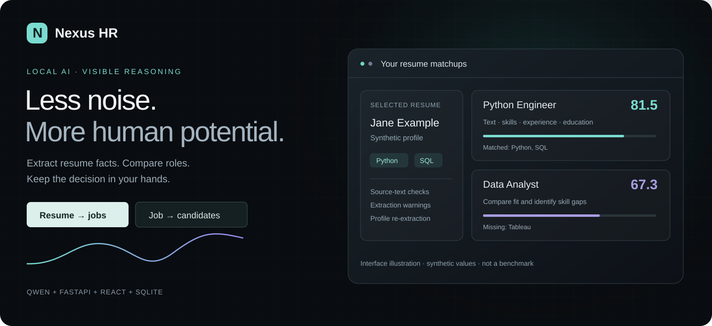
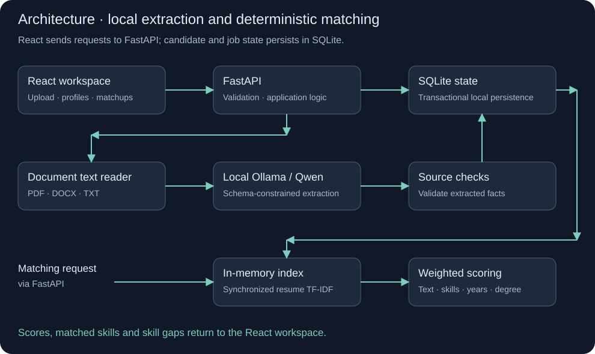
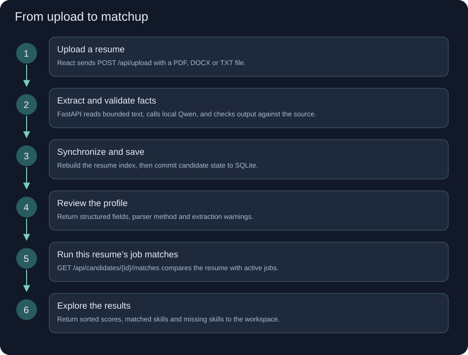
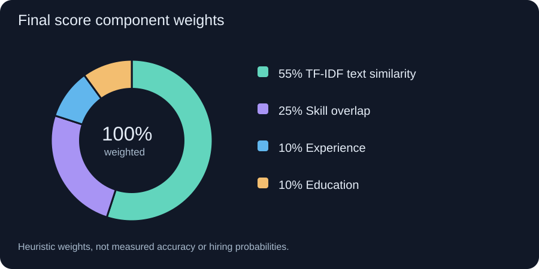

<div align="center">

# Nexus HR

### A clearer view of talent. A more understandable match.

Local resume extraction, two-way job matching, and a glass-styled recruitment workspace.

[](https://github.com/Sharingan001/Ai-Based-Resume/actions/workflows/ci.yml)
[](api/requirements.txt)
[](frontend/package.json)
[](https://ollama.com/library/qwen3:4b-instruct)
[](LICENSE)

[Quick start](#quick-start) · [Interactive workspace](#interactive-workspace) · [Architecture](#architecture) · [Scoring](#how-matching-is-scored) · [API](#api-reference) · [Troubleshooting](#troubleshooting)

</div>



*Interface illustration using synthetic profile data and demonstration scores. It does not contain uploaded resumes or measured accuracy results.*

## What the project does

Nexus HR turns a PDF, DOCX, or TXT resume into a structured candidate profile, then helps you compare that profile with job requirements. Qwen extracts resume facts locally through Ollama. A separate, deterministic scoring engine compares resume text, skills, experience, and education with a job.

The workspace supports two distinct questions:

| Your question | Matching mode | What appears |
| --- | --- | --- |
| “Which roles match my resume?” | **My resume → jobs** | Select an uploaded resume and compare its scores across active jobs, up to 100 results. |
| “Which uploaded resumes fit this role?” | **Job → candidates** | Select a job and rank uploaded resumes; optionally include the complete candidate pool. |

A low score remains visible in the resume-to-jobs view. A resume should not disappear simply because demonstration candidates outrank it.

## What makes this implementation distinctive

| Design choice | Practical value | Implementation |
| --- | --- | --- |
| **Two-way matching** | Applicants can explore roles; recruiters can compare candidates. | Resume-specific and job-specific API flows. |
| **Source-grounded extraction** | Unsupported generated names, employers, skills, and education fields are omitted. | Pydantic schema plus source-text checks. |
| **Honest unknowns** | Missing details stay unknown rather than becoming invented qualifications. | Empty fields, extraction warnings, and parser provenance. |
| **Local model inference** | The configured extraction path calls local Ollama. | Official `qwen3:4b-instruct`; no hosted LLM API key required. |
| **Visible score components** | Readers can inspect why a score is high or low. | Text, skill, experience, and education breakdowns; matched/missing skills. |
| **Recoverable extraction** | Reprocess a stored resume after improving the model or parser. | **Re-extract with Qwen** preserves the candidate ID and workflow status. |
| **Transactional state** | Candidate/job changes are persisted together. | SQLite state snapshot; synchronized in-memory search index. |
| **Independent C++ score utility** | Demonstrates the weighted-score calculation outside Python. | C++17 CLI with input validation and parity tests. |

These are implementation characteristics, not claims that the project is unique across all recruiting products. Scores are heuristics, not hiring recommendations or probabilities.

## Interactive workspace

| Screen | Interactions | Result |
| --- | --- | --- |
| **Dashboard** | Open upload, matching, and analytics actions. | Candidate/job totals and category statistics. |
| **AI Screening** | Drop or select resumes; inspect warnings and parsed fields. | Structured profiles with links to their own job matchups. |
| **Candidate profile** | Review experience/education, change status, re-extract the source. | Updated profile with visible extraction provenance. |
| **My resume → jobs** | Switch resumes, run matching, filter by job title, department, or skill. | Sorted role scores with matched and missing skills. |
| **Job → candidates** | Select a job, choose uploaded/all candidates, change Top-N, export CSV. | Candidate ranking within the selected pool. |
| **Job Descriptions** | Create a role and add required/preferred skills. | A new active job available for matching. |
| **Analytics** | Inspect chart tooltips and candidate distributions. | A view of the stored talent pool. |
| **Settings** | Change appearance, save browser preferences, test an API URL. | Browser-local preferences and backend/model health information. |

### Motion and visual design

- Translucent navigation, cards, tables, controls, and dialogs with restrained teal/violet accents.
- Page transitions, staggered entrances, hover sheen, and dialog entrance animations.
- Responsive navigation and layouts for narrow screens.
- Reduced-motion overrides for ambient movement and decorative transitions.
- Static blur concentrated in navigation and dialogs rather than animated blur across every card.

The repository illustration above is static; explore the running app to see interactions and motion.

## Architecture



| Layer | Technology | Responsibility |
| --- | --- | --- |
| Interface | React 19, TypeScript, Vite | Routes, candidate views, and matching interactions. |
| UI state | TanStack Query, Axios | Data loading, refreshing, and API requests. |
| Presentation | Tailwind CSS, Framer Motion, Recharts | Styling, motion, and charts. |
| API | FastAPI, Pydantic | Request validation and application operations. |
| Extraction | Ollama, Qwen3 4B Instruct | Structured resume-field extraction. |
| Document reading | pypdf, python-docx | PDF text, DOCX paragraphs, and table text. |
| Matching | scikit-learn | TF-IDF cosine similarity and feature scoring. |
| Persistence | SQLite | Local candidate/job state. |
| Optional CLI | C++17 | Weighted final score from four input components. |

## From upload to matchup



If model extraction is unavailable or invalid, new uploads can use a regex fallback with a manual-review warning. A failed **re-extraction** preserves the existing profile instead of replacing it with fallback data.

## How matching is scored



```text
Final score = 0.55 × text similarity
            + 0.25 × skill overlap
            + 0.10 × experience
            + 0.10 × education
```

Each component is on a 0–100 scale. The final score is capped at 99.9 and uses half-up rounding to one decimal place.

| Component | Current calculation | Interpretation |
| --- | --- | --- |
| Text similarity | Resume-fitted TF-IDF, English stop words, unigrams/bigrams, up to 8,000 features, cosine similarity. | Vocabulary overlap; this is not an embedding-based understanding model. |
| Skills | Exact, case-insensitive overlap with the job's listed skills. Required/preferred skills contribute 80/20 when both exist. | Skill aliases and differently worded equivalents may not match. |
| Experience | Extracted years relative to the first numeric year requirement, capped at 100. | A heuristic; complex job requirements are not fully interpreted. |
| Education | Deterministic degree-keyword score. | A simple degree-level heuristic, not a job-specific qualification check. |

When only one skill group exists, it receives the entire skill component. If neither group exists, the skill component is 50.

<details>
<summary><strong>Worked example: reproduce a final score</strong></summary>

Given text similarity **80**, skills **100**, experience **50**, and education **75**:

```text
0.55 × 80 + 0.25 × 100 + 0.10 × 50 + 0.10 × 75 = 81.5
```

After building the optional C++ executable:

```powershell
.\cpp\build\nexus_score.exe 80 100 50 75
# 81.5
```

This is a mathematical example, not an evaluation of a real candidate.

</details>

## Quick start

### Requirements

- **Python 3.10+**; GitHub Actions tests Python 3.12.
- **Node.js 22.12+** recommended; Node 20.19+ is also supported by the launcher.
- **Ollama** with `qwen3:4b-instruct` downloaded.
- A C++17 compiler only if you want the optional score CLI.

### Windows: launch the complete app

```powershell
git clone https://github.com/Sharingan001/Ai-Based-Resume.git
cd Ai-Based-Resume
ollama pull qwen3:4b-instruct
.\start.bat
```

The launcher creates `.venv`, installs dependencies when manifests change, starts local Ollama when necessary, verifies the model, waits for API/frontend readiness, and opens the browser. Healthy existing services are reused.

| Service | Default address |
| --- | --- |
| Web workspace | [http://127.0.0.1:5173](http://127.0.0.1:5173) |
| API health | [http://127.0.0.1:8000/api/health](http://127.0.0.1:8000/api/health) |
| Interactive API docs | [http://127.0.0.1:8000/docs](http://127.0.0.1:8000/docs) |
| Ollama | `http://localhost:11434` |

**A fresh checkout has no private resumes or preloaded job database.** First create a job under **Job Descriptions**, upload a resume under **AI Screening**, then choose **See this resume's job matches**.

<details>
<summary><strong>Launcher options and logs</strong></summary>

```powershell
.\start.bat --no-browser
.\start.bat --check-only
.\start.bat --no-browser --build-cpp
```

- `--no-browser`: run without opening a browser tab.
- `--check-only`: print environment/service status and verify the configured Ollama model.
- `--build-cpp`: also compile and smoke-test the optional C++ utility.
- Startup logs live in `.runtime/`; the launcher reports failures and port conflicts.
- Existing datasets are not regenerated during startup.
- Closing the launcher does not stop the background servers.

</details>

<details>
<summary><strong>Manual startup: Windows, macOS, or Linux</strong></summary>

Start Ollama if its service is not already running:

```text
ollama serve
```

In the project root, create a virtual environment and start the API:

```text
python -m venv .venv
```

Activate it using your platform's command:

| Platform | Activation |
| --- | --- |
| Windows PowerShell | `.\.venv\Scripts\Activate.ps1` |
| Windows Command Prompt | `.venv\Scripts\activate.bat` |
| macOS / Linux | `source .venv/bin/activate` |

```text
python -m pip install -r api/requirements.txt
python -m uvicorn api.main:app --host 127.0.0.1 --port 8000
```

In another terminal:

```text
cd frontend
npm ci
npm run dev -- --host 127.0.0.1 --port 5173 --strictPort
```

Use one backend process. Multiple independent workers are not supported by the in-memory search index.

</details>

## Qwen configuration and extraction safeguards

The default is official [Qwen3 4B Instruct](https://ollama.com/library/qwen3:4b-instruct), using Ollama locally. Runtime settings use an **8,192-token context**, deterministic decoding, an output JSON schema, a 2,048-token generation limit, and one generation at a time to reduce GPU contention. This is inference configuration, not fine-tuning.

| Safeguard | Behavior |
| --- | --- |
| Schema validation | Validates field types, arrays, and bounded experience. |
| Source-text grounding | Omits generated text fields not found in the supplied source sections. |
| Contact extraction | Copies email and phone matches from source text. |
| Experience handling | Uses explicit year statements or merged dated employment intervals. |
| Instruction handling | Excludes obvious instruction-like lines and reports a warning. |
| Long resumes | Processes first/last 8,000 characters when the source exceeds 16,000; marks partial extraction. |
| Provenance | Records parser method, model name, and extraction warnings. |

These safeguards reduce unsupported output. They do not establish whether a resume is truthful, guarantee correct section associations, or provide general accuracy guarantees.

<details>
<summary><strong>Environment variables</strong></summary>

Set backend variables before launching it:

```powershell
$env:OLLAMA_MODEL = "qwen3:4b-instruct"
$env:OLLAMA_URL = "http://localhost:11434"
```

| Variable | Purpose |
| --- | --- |
| `OLLAMA_MODEL` | Installed Ollama model tag; default `qwen3:4b-instruct`. |
| `OLLAMA_URL` | Ollama base URL. |
| `NEXUS_STATE_DB` | Optional alternative SQLite state path. |
| `CORS_ORIGINS` | Comma-separated allowed frontend origins. |
| `NEXUS_API_TOKEN` | Optional shared-instance API token. |
| `VITE_API_URL` | Frontend API base URL, including `/api`. |
| `VITE_API_TOKEN` | Matching frontend token for a trusted shared instance. |

`api/.env.example` is a reference and is not automatically loaded by the server. Vite reads its frontend environment files. The frontend API URL can also be saved in Settings; reload to apply it. A saved browser URL takes precedence over the build-time URL.

A frontend token is visible to its users. It is not a user account, role system, or tenant boundary.

</details>

## API reference

Explore request/response schemas at [the local Swagger UI](http://127.0.0.1:8000/docs).

| Method | Endpoint | Purpose |
| --- | --- | --- |
| `GET` | `/api/health` | Data/index readiness, counts, and Ollama configuration/availability. |
| `GET` | `/api/overview` | Talent-pool metrics and chart distributions. |
| `GET`, `POST` | `/api/jobs` | List jobs or create a role. |
| `GET` | `/api/jobs/{id}` | Inspect one job. |
| `GET` | `/api/candidates` | Paginated list; search, category, status, and source filters. |
| `GET` | `/api/candidates/stats` | Candidate status counts. |
| `GET` | `/api/candidates/{id}` | Structured candidate profile. |
| `PATCH` | `/api/candidates/{id}/status?status=Reviewed` | Change workflow stage. |
| `POST` | `/api/upload` | Upload a PDF, DOCX, or TXT resume. |
| `POST` | `/api/candidates/{id}/reparse` | Re-extract stored source text with Qwen. |
| `GET` | `/api/candidates/{id}/matches?top_n=100` | Compare one resume with active jobs. |
| `POST` | `/api/match` | Rank a candidate pool for a selected job. |

<details>
<summary><strong>Example: rank only uploaded resumes</strong></summary>

Obtain a job ID from `GET /api/jobs`, then send:

```json
{
  "job_id": "YOUR_JOB_ID",
  "top_n": 20,
  "source": "uploaded"
}
```

`source` can be `uploaded` or `all`. The API defaults to `all` for compatibility; the job-ranking UI defaults to uploaded resumes. An optional `candidate_id` targets one resume. Top-N is limited to 1–100 and applies within the selected pool.

</details>

## Persistence, datasets, and privacy

Candidate and job changes are stored together in `api/state.sqlite3` using a SQLite transaction. Startup loads this file first; if it is absent, optional JSON seed files are loaded. Without either, the app starts empty. Back up SQLite state before migrations or replacement.

| Included in GitHub | Kept local / excluded |
| --- | --- |
| Application source and configuration examples | `.env` credentials and browser-local preferences |
| Synthetic unit-test fixtures | Uploaded resumes and runtime SQLite state |
| Sanitized exploratory notebook | Original CSV/ZIP datasets and structured seed databases |
| C++ source, CI, and documentation | Installed models, `.venv`, `node_modules`, caches, and logs |

Legacy source datasets had 2,484 resume rows and 853 job-description rows. They are not required to try the app and are not bundled in this repository. Some legacy seed identities, statuses, and requirements were demonstration data; do not treat them as verified operational facts.

<details>
<summary><strong>Optional legacy preprocessing and exploration</strong></summary>

If you supply the corresponding CSV files yourself:

```text
python api/preprocess.py
```

This generates missing JSON seed files. Deliberate replacement uses `--only jobs --replace` or `--only candidates --replace`; existing seed files receive `.bak` copies. Runtime SQLite state is not replaced by seed generation.

Batch model extraction may take hours. The launcher does not run it implicitly.

`Resume.ipynb` and `resume.py` are exploratory alternatives with different scoring. Install root `requirements.txt` for their dependencies. The notebook downloads NLTK corpora; its classifier is not the deployed API model.

</details>

## Validation and CI

The project has **21 test methods**, covering extraction/grounding, invalid documents, persistence, matching scopes, re-extraction, API-token behavior, and the C++ score utility. The C++ tests include eight boundary/invalid-input cases and 100 deterministic score comparisons.

```powershell
python -m pip install -r api/requirements-dev.txt
python -m unittest discover -s tests -v
npm ci --prefix frontend
npm run build --prefix frontend
npm run lint --prefix frontend
npm audit --prefix frontend --audit-level=moderate
```

For C++, see [build instructions](cpp/README.md). Compile the utility before running its Python wrapper tests; otherwise those two methods are skipped. On Windows, the launcher supports `--build-cpp`. On Linux:

```sh
mkdir -p cpp/build
g++ -std=c++17 -Wall -Wextra -Werror -O2 cpp/main.cpp -o cpp/build/nexus_score.exe
```

[GitHub Actions](https://github.com/Sharingan001/Ai-Based-Resume/actions/workflows/ci.yml) compiles C++, runs the tests on synthetic fixtures, builds/lints the frontend, and audits frontend dependencies. CI does not need Ollama or private datasets. Live model extraction and empty-database upload/matching were checked separately during development; that small fixture set is not a general accuracy benchmark.

## Troubleshooting

<details>
<summary><strong>My resume does not appear in a job's top results</strong></summary>

Use **AI Ranking → My resume → jobs** to compare your selected resume with roles. In **Job → candidates**, choose **Uploaded resumes only** so demonstration candidates do not crowd out your uploads. Low scores stay visible in the resume-to-jobs view. Check that at least one active job exists.

</details>

<details>
<summary><strong>The extracted profile is incorrect or outdated</strong></summary>

Open the profile, inspect its provenance/warnings, and choose **Re-extract with Qwen**. Changing the model does not automatically rewrite existing profiles. Successful re-extraction preserves the ID, status, application date, and category. A failed model attempt leaves the existing profile intact.

</details>

<details>
<summary><strong>Ollama is unavailable or the configured model is missing</strong></summary>

Check `ollama list`, download `qwen3:4b-instruct` if needed, and confirm the service is reachable at the configured URL. Use `start.bat --check-only` for diagnostics. New uploads may use a regex fallback with a review warning; re-extraction requires successful model output.

</details>

<details>
<summary><strong>Uploads fail, services cannot start, or settings seem unchanged</strong></summary>

- Maximum upload size is 5 MB. Use text-readable PDF, DOCX, or UTF-8 TXT.
- Scanned/image-only PDFs need OCR elsewhere; binary `.doc` is unsupported.
- Check `.runtime` startup logs and whether ports 8000/5173 are occupied.
- Profile/preferences/API URL are browser-local. Reload after changing the API URL.
- Account, password, 2FA, avatar, and notification-delivery features are not implemented.

</details>

## Current scope and limits

This is a local project with one backend process. It has no complete user-authentication system, tenant isolation, audit-log product, OCR pipeline, or calibrated ranking-quality evaluation. The launcher binds to loopback. Optional shared-token protection is for trusted instances; public deployment requires additional work.

The dashboard pipeline timeline is labeled demonstration data. Employer/role charts describe candidate history. Time savings are unmeasured. Text checks and transparent scoring help review; human judgment remains necessary.

## Repository guide

```text
api/                   FastAPI, Qwen extraction, preprocessing
frontend/src/          React pages, UI components, API client
scripts/start.py       Windows launcher implementation
start.bat              Double-click entry point
cpp/                   Optional C++17 weighted-score utility
tests/                 Synthetic fixtures and regression tests
.github/workflows/     Continuous-integration checks
docs/assets/           Public, synthetic documentation visuals
Resume.ipynb           Sanitized exploratory notebook
resume.py              Legacy Streamlit dashboard
```

See [PROJECT_REVIEW.md](PROJECT_REVIEW.md) for the original audit and [FIXES.md](FIXES.md) for implementation/verification notes.

## License and acknowledgments

[MIT License](LICENSE). The repository is maintained under **Sharingan001 / Ishan Munday**. Original project work by **Harsha Vardhan Maradana** is acknowledged; both copyright attributions are retained in the license.
